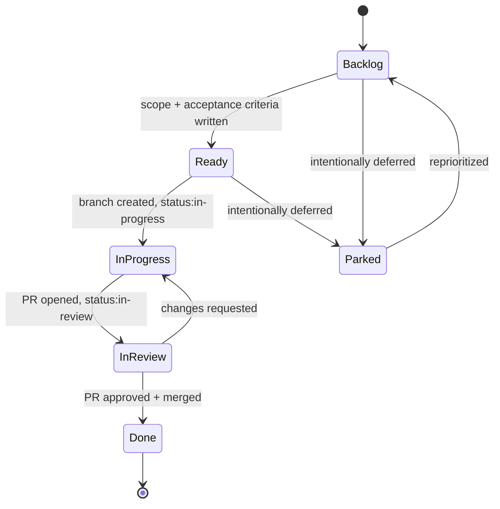

# <Project Name> SPEC

## Insight

The issue tracker should not become storage for vague app ideas. Every issue should map to a measurable product loop: activation, retention, revenue, trust, or distribution.

The current highest-leverage issue family is not "more features." It is `<strategic bottleneck>`.

## Decision

Use this spec as the execution bridge between project docs and GitHub Issues.

Issue hierarchy:

```text
Repo: <org>/<repo>
  -> GitHub Project: <Project Name> <release> - <initiative>
  -> Epic labels: activation, retention, trust, revenue, distribution, release
  -> Issues: shippable slices sized 0.5-2 days, each on its own branch and PR
```

Do not create issues larger than one independently verifiable product slice.

## Sync Model

### Project

Recommended GitHub Project:

```text
<Project Name> <release> - <initiative>
```

Project URL:

```text
https://github.com/orgs/<org>/projects/<number>
```

Repo:

```text
https://github.com/<org>/<repo>
```

Project outcome:

```text
<A measurable user/business outcome for this release>
```

Project success metrics:

- `<activation metric>`
- `<retention metric>`
- `<trust metric>`
- `<revenue metric>`
- `<distribution metric>`

### Epic Types

| Epic Label | Outcome | Owner Surface |
| --- | --- | --- |
| `epic:activation` `<name>` | User reaches first value faster | onboarding, home, setup |
| `epic:retention` `<name>` | User has a reason to return | reminders, streaks, weekly loop |
| `epic:trust` `<name>` | Claims and data are correct | calculations, persistence, outputs |
| `epic:revenue` `<name>` | User can pay after value is shown | entitlements, paywall, checkout |
| `epic:distribution` `<name>` | Product creates share or channel artifact | exports, referrals, store assets |
| `epic:release` `<name>` | Build is shippable | CI, tests, localization, routing, release checks |

### Labels

Recommended GitHub labels (create once in repo settings or via `gh label create`):

- `activation`
- `retention`
- `revenue`
- `trust`
- `distribution`
- `release-blocker`
- `priority:p0`
- `priority:p1`
- `status:ready`
- `status:in-progress`
- `status:in-review`
- `status:parked`
- `<domain-label>`

## Issue Template

The canonical issue body lives in `.github/ISSUE_TEMPLATE/feature_request.md` so it renders as a GitHub issue form. Its structure:

```markdown
## Outcome

What user or business behavior changes?

## Scope

- In:
- Out:

## Product Rule

Activation, retention, revenue, trust, or distribution reason.

## Implementation Notes

Likely files, providers, DAOs, routes, localization, APIs, migrations, or device surfaces.

## Acceptance Criteria

- [ ] User-visible behavior works
- [ ] Edge or empty state handled
- [ ] Copy/localization updated if needed
- [ ] Tests added or updated where risk is non-trivial
- [ ] Analyze/lint passes
- [ ] Tests pass or known unrelated failures are documented in the PR

## Analytics

Events to add or verify.

## Risks

What could break trust, data correctness, revenue, distribution, or release readiness?
```

## Current Execution Backlog

### P0-1: `<Issue Title>`

Epic:

```text
Activation: <Epic Name>
```

Outcome:

```text
<Concrete user outcome>
```

Scope:

- `<in scope item>`
- `<in scope item>`
- `<in scope item>`

Out:

- `<out of scope item>`
- `<out of scope item>`

Likely files:

- `<app_folder>/lib/features/<feature>/`
- `<app_folder>/lib/core/<area>/`
- `<app_folder>/test/<area>/`

Acceptance:

- `<acceptance criterion>`
- `<acceptance criterion>`
- `<acceptance criterion>`

Branch / PR:

```text
git checkout -b feature/<issue-number>-<short-slug>
gh pr create --fill --title "<Issue Title>" --body "Closes #<issue-number>"
```

### P0-2: `<Issue Title>`

Epic:

```text
Trust: <Epic Name>
```

Outcome:

```text
<Concrete trust/data outcome>
```

Scope:

- `<in scope item>`
- `<in scope item>`

Acceptance:

- `<acceptance criterion>`
- `<acceptance criterion>`

### P1-1: `<Issue Title>`

Epic:

```text
Revenue: <Epic Name>
```

Outcome:

```text
<Concrete revenue or monetization outcome>
```

Scope:

- `<in scope item>`
- `<in scope item>`

Acceptance:

- `<acceptance criterion>`
- `<acceptance criterion>`

## Status Rules

Use simple statuses, tracked as labels or GitHub Project board columns:

- Backlog: not selected for current sprint
- Ready: clear scope and acceptance criteria (`status:ready`)
- In Progress: actively being implemented on a branch (`status:in-progress`)
- In Review: PR open, code complete, waiting for CI/review pass (`status:in-review`)
- Done: PR merged, issue auto-closed via `Closes #<number>`, verification noted in the PR
- Parked: valid but intentionally deferred (`status:parked`)



Do not close an issue unless the acceptance criteria are satisfied or the remaining gap is written directly in the issue or PR.

For autonomous agent runs:

- move `Backlog` or `Ready` issues to `status:in-progress` and open a draft PR before editing further
- leave completed implementation work as an open PR in `status:in-review`, not merged
- add a PR comment containing what changed, verification commands, pass/fail result, and next risk
- do not merge sensitive data, entitlement, payment, notification, migration, hardware, or AI-decision work directly; require human review

## Sprint Shape

Recommended first sprint:

```text
Sprint 1: <Theme>
  P0-1 <Issue>
  P0-2 <Issue>
  P0-3 <Issue>
```

Reason:

- directly improves `<activation/retention/revenue/trust/distribution>`
- validates `<key assumption>`
- removes `<major blocker>`

## Definition Of Ready

An issue is ready when it has:

- clear user outcome
- one owner surface
- explicit non-goals
- acceptance criteria
- likely file areas
- test expectation
- activation, retention, revenue, trust, or distribution rationale
- the `status:ready` label

## Definition Of Done

An issue is done when:

- the user-visible behavior works
- data is persisted or migrated safely if needed
- empty and error states are handled
- copy/localization is updated if needed
- analytics events are added or consciously deferred
- CI (`.github/workflows/ci.yml`) passes on the PR
- at least one review approval is recorded (unless solo-merge is explicitly allowed)
- the PR is merged and the issue is closed via `Closes #<number>`

## Release Gate

Before public release work, verify:

- onboarding produces first-session value
- core loop is correct and repeatable
- product claims do not overpromise
- premium users have a working entitlement path if monetized
- locked paid actions have a clear upgrade path
- notifications are permission-aware if used
- public naming matches the brand
- `main` is green on CI and tagged for the release
